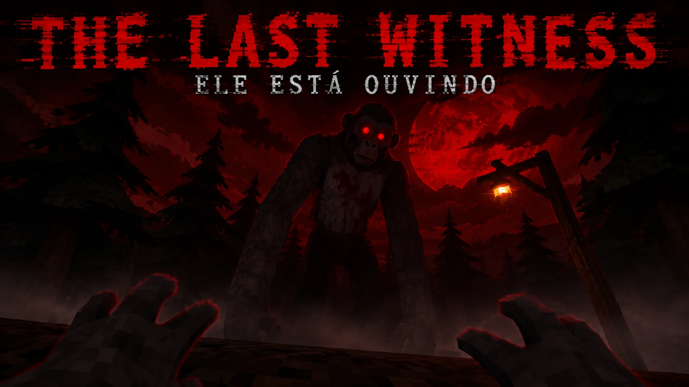

# The Last Witness



Mod de terror para **Gorilla Tag** (BepInEx). A floresta vira um pesadelo: uma barra de sanidade que só piora,
eventos sempre aleatórios, a Testemunha te perseguindo, jumpscares, corrupção do mundo, céu sinistro, iluminação
dinâmica do Ghost Reactor e uma história em 8 fitas.

> Só funciona **offline ou em sala privada**. Em sala pública o mod fica desligado.

## O que tem
- **Sanidade:** cai com o tempo e com os sustos; quanto mais baixa, mais pesados os eventos e mais corrompido o mundo.
- **Diretor:** fases de calma, tensão, pico e alívio, em atos; nunca repete os últimos eventos grandes, tem
  emboscadas e falsos alarmes.
- **29 eventos** (cada um pode ser desligado no menu), por exemplo:
  - sinais: sussurros, passos, glitch, objetos mudando de lugar, mensagens, olhos, anomalias, dia/noite trocando, gravidade;
  - grandes: stalker, perseguição, jumpscares (5 estilos), apagão, doppelgänger, contagem regressiva com perseguição,
    hora vermelha, colapso, corrupção, multidão, mímico, gigante, desconexão falsa, desorientação.
- **A Testemunha:** duas formas, o gorila sombra preto e o modelo do Sketchfab (créditos abaixo), com animação.
- **Ela te ouve:** usa o microfone do jogo; falar alto chama a atenção dela.
- **Modos:** *As Fitas* (história com 8 fitas, adereços, final e dois desfechos) e *Pesadelo sem fim*. No
  *Pesadelo sem fim* + *Terror absoluto* só rodam os eventos mais pesados, e com sanidade -1 vem o *Inferno*:
  todos os eventos, um a cada 5-7 s.
- **Ambiente:** iluminação dinâmica do Ghost Reactor (postes, lanterna, olhos vermelhos, luz negativa), céu
  próprio em 3 estágios, neblina, trilha que acompanha a tensão.
- **Menu** (estilo MonkeCraft): intensidade Fácil / Média / Difícil / Terror absoluto, eventos, conforto (flashes
  suaves, sem efeitos de movimento, escuridão máxima, volume, sensibilidade do microfone) e diário.

## Controles
- **B ou Y duas vezes:** abre / fecha o menu. Aponte com o laser e use o gatilho para clicar.
- O mod começa **desligado** a cada vez que o jogo abre: ligue em *Começar a noite*.

## Instalar
1. Tenha o Gorilla Tag (Steam) com o **BepInEx 5** instalado, como para qualquer mod.
2. Em **[Releases](../../releases)**, baixe o `TheLastWitness.dll` da versão mais nova.
3. Coloque o arquivo em `Gorilla Tag\BepInEx\plugins\`. Pronto: o modelo da Testemunha e os sons já vão dentro da DLL.

Para remover: apague `TheLastWitness.dll` e `BepInEx\config\dev.thelastwitness.gorillatag.cfg`.

> A DLL pública não traz três músicas de uso privado (trilha principal, contagem e final). Sem elas o mod usa
> a trilha sintetizada e o final reserva. Quem tiver um `witness.bundle` completo pode deixá-lo ao lado da DLL: ele tem prioridade.

## Compilar
Precisa do .NET SDK e do Gorilla Tag instalado (o projeto só referencia as DLLs do jogo, nada do jogo vai no repositório).

```bash
cd gorillatag
dotnet build -c Release -p:GameDir="C:\Program Files (x86)\Steam\steamapps\common\Gorilla Tag" -p:BepInExCore="C:\caminho\para\BepInEx\core"
```

Saída: `gorillatag/bin/Release/net472/TheLastWitness.dll`.

### witness.bundle (modelo e sons)
Projeto Unity **6000.2.9f1** em `unity/` (com glTFast). O menu/método `BuildWitness` faz o bake das poses do modelo
em malhas estáticas, importa tudo de `Assets/Sounds/*.wav` e gera `unity/Build/witness.bundle`:

```bash
Unity.exe -batchmode -quit -projectPath unity -executeMethod BuildWitness.Build
```

Três sons são de uso privado e não estão no repositório: veja [unity/Assets/Sounds/PRIVATE.md](unity/Assets/Sounds/PRIVATE.md).

## Testes (desenvolvimento)
`tools/gt.sh` abre uma cópia de teste do GT com BepInEx isolado e manda comandos ao mod por
`%LOCALAPPDATA%\TheLastWitness\cmd.req` (ex.: `event stalker`, `sanity 20`, `tape 8`, `eye`, `snap nome`).
Os comandos estão em `Plugin.TestHooks`.

## Estrutura
| Arquivo | O que faz |
|---|---|
| `Plugin.cs` | Entrada do BepInEx, liga/desliga, ganchos de teste |
| `Director.cs` | Ritmo: fases, atos, escolha de eventos, Inferno |
| `Events.cs` | Todos os eventos, perseguições e jumpscares |
| `Story.cs` | Modo *As Fitas*: fitas, adereços, final, desfechos |
| `Fx.cs` | Telas, escuridão, trilha, sons, helpers |
| `Synth.cs` | Sons procedurais |
| `Entity.cs`, `Anim.cs` | A Testemunha: carregamento, formas, animação |
| `Lights.cs`, `Ambience.cs` | Iluminação do Ghost Reactor, postes, lanterna, clima |
| `Sky.cs`, `Decay.cs` | Céu próprio, corrupção do mundo |
| `Menu.cs`, `Settings.cs` | Menu e configurações |
| `Hearing.cs` | Microfone |

## Créditos
Veja [CREDITS.txt](CREDITS.txt). Modelo da Testemunha: "gorilla tag horror rig (credits to wiz)" de IdkmaneGTH,
baseado no "Gorilla Tag Ik Rig" de wiz (CC-BY-4.0). Sons gravados do Freesound (CC0). Código escrito com Claude (IA).

Mod não oficial, sem ligação com a Another Axiom.
